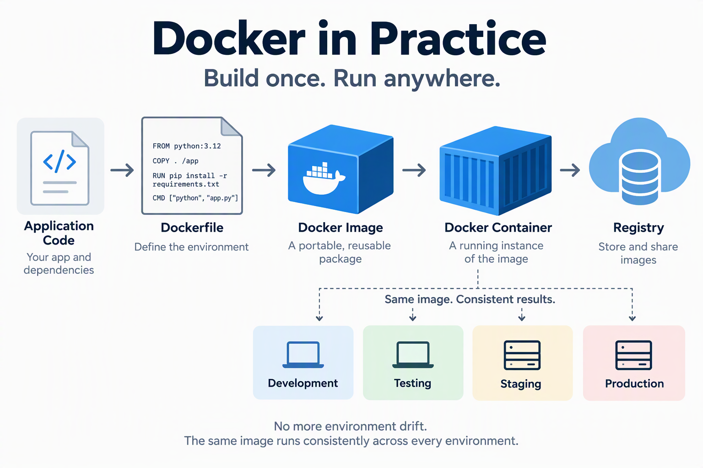

# Docker in Practice

This is the companion repository for the book *Docker in Practice: A Practical Guide to Images, Containers, Dockerfiles, Compose, Registries, and Debugging* by **Victor Ebai**. It provides ready-to-use application files, Dockerfiles, Compose configurations, and chapter-based lab guides.

## Get the paperback

**[Amazon UK — Paperback](https://www.amazon.co.uk/dp/B0HPGQQ86V)** · [Amazon US — Paperback](https://www.amazon.com/dp/B0HPGQQ86V) · [Amazon India — Find paperback by ISBN](https://www.amazon.in/s?k=9798165620041&i=stripbooks)

**Quick navigation:** [Getting started](#getting-started) · [Chapter index](#choose-a-chapter) · [Lab workflow](#two-ways-to-work) · [Validation](#optional-automated-chapter-validation) · [Cleanup](#safe-verification-and-cleanup)

## From application code to running containers

Docker packages application code and runtime dependencies into an image. You use a Dockerfile to define the build, run containers from the resulting image, and use a registry to distribute images. The same application image can support development, testing, staging, and production when the runtime environment is configured appropriately.



*From application code to image, container and registry. Registries store images rather than running containers; consistent results also depend on configuration, platform compatibility, and permissions.*

**The book is fully self-contained.** You do not need this repository to understand or complete its learning path. This companion provides convenient, testable copies of the example files and guided exercises.

Build and optimise Docker images, run and inspect containers, use volumes and networks, add health and resource controls, **run multi-service Compose applications**, investigate failures using container evidence, and prepare images for CI/CD.

The practical workflow is **Build → Observe → Break → Diagnose → Fix → Verify**. Use the book for the explanations and engineering judgement; use this repository to find the relevant files, run the labs, and verify outcomes.

## What you will build and practise

By working through the exercises, you will learn to:

- **Build repeatable images** using Dockerfiles, caching, multi-stage builds, and appropriate image tags.
- **Run and configure containers** with environment variables, safer secret handling, volumes, and Docker networks.
- **Check application behaviour** using health checks, resource limits, container state, exit codes, and logs.
- **Operate multi-container applications** with Docker Compose and prepare images for CI/CD publication.
- **Diagnose and repair failures** using reproducible, chapter-scoped exercises.

The final project brings together Node.js, PostgreSQL, and Redis in a small Compose stack that you can build, inspect, troubleshoot, and clean up safely.

## Before you begin

**First-time setup:** [Install Docker, Docker Compose, and supporting tools](docs/SETUP.md).

You need:

- **Docker Desktop** (macOS/Windows) or **Docker Engine** (Linux), running and accessible from your terminal.
- The modern **`docker compose`** command, **Git**, and **`curl`** (or a browser for HTTP verification).
- **Node.js and npm on your host** for the lock-file exercises in Chapters 3, 4, and 13.
- A macOS or Linux terminal, or a Bash-compatible WSL 2 terminal on Windows.
- An optional registry account for the image-publishing work in Chapter 12.

**Safety:** Use a disposable local environment. Do not commit real credentials, expose practice passwords, or publish unnecessary ports. Inspect container and volume ownership before cleanup; deleting named volumes can permanently remove lab data. No AWS account is required.

## Getting started

**1. Clone the repository** in your own terminal:

```bash
git clone https://github.com/vebai/docker-in-practice.git
cd docker-in-practice
```

**2. Verify your tools** and that the Docker engine is running:

```bash
docker --version
docker compose version
docker run --rm hello-world
```

**3. Choose a chapter.** Beginners can start with the [first container exercise](chapters/chapter-01-first-container/README.md). Each chapter guide identifies the files, commands, expected evidence, and safe cleanup. Chapters generally use independent examples.

**4. Check the local example files** without starting containers:

```bash
bash tests/validate-files.sh
```

For runtime exercises and chapter-specific automation, follow the [validation guide](validation/README.md). A passing offline check does not prove that a running application works.

## Choose a chapter

| Chapter | Exercise | Starting point |
|---|---|---|
| [01](chapters/chapter-01-first-container/README.md) | Run your first container | No project files required |
| [02](chapters/chapter-02-images-and-containers/README.md) | Pull, run and inspect an image | Independent |
| [03](chapters/chapter-03-dockerfiles/README.md) | Build static, Node.js and Python images | [Three runnable projects](examples/chapter-03-dockerfiles/) |
| [04](chapters/chapter-04-multi-stage-builds/README.md) | Compare Go image sizes | [Go project](examples/chapter-04-multi-stage-builds/go-demo/) |
| [05](chapters/chapter-05-environment-and-secrets/README.md) | Configure a Node.js container | [Environment example](examples/chapter-05-environment-and-secrets/env-demo/) |
| [06](chapters/chapter-06-volumes-and-networks/README.md) | Test persistence and DNS networking | Independent, disposable |
| [07](chapters/chapter-07-health-checks/README.md) | Verify healthy and unhealthy containers | [Node health-check example](examples/chapter-07-health-checks/) |
| [08](chapters/chapter-08-resource-limits/README.md) | Inspect CPU and memory limits | Independent, disposable |
| [09](chapters/chapter-09-container-logs/README.md) | Read and filter log evidence | Independent, disposable |
| [10](chapters/chapter-10-docker-compose/README.md) | Run a three-service stack | [Compose example](examples/chapter-10-docker-compose/) |
| [11](chapters/chapter-11-debugging/README.md) | Diagnose a broken container | [Controlled failure](examples/chapter-11-debugging/) |
| [12](chapters/chapter-12-container-cicd/README.md) | Build, test and optionally push an image | [CI example](examples/chapter-12-container-cicd/) |
| [13](chapters/chapter-13-final-project/README.md) | Run Node.js, PostgreSQL and Redis | [Final project](examples/chapter-13-final-project/) |

Each chapter README gives the starting directory, commands to run, expected evidence, troubleshooting and targeted cleanup. Chapter examples generally run independently. The final project combines the skills into a complete multi-service application.

## Two ways to work

**Follow the book:** Read the chapter, predict the outcome, use its commands, then compare your result with the expected evidence.

**Use the supplied files:** Start in the matching chapter README after cloning the repository. The examples are deliberately small and editable; the book explains the underlying concepts and engineering decisions.

## Optional automated chapter validation

The reader-facing book is self-contained. The optional `validation/` directory
contains one shell script per chapter and a master runner with named
checkpoints, captured logs and safe, chapter-scoped cleanup.

From the repository root, on your Mac/Linux workstation with Docker running:

```bash
chmod +x validation/*.sh
./validation/run-all.sh --list
./validation/run-all.sh --status
./validation/run-all.sh --chapter 05
```

To continue after a successful Chapter 5:

```bash
./validation/run-all.sh --from 06
```

**Failure handling:** inspect `validation/results/chapter-NN.log` and the
named `bookval-chNN-*` resources *before* running
`./validation/chNN.sh cleanup` and resuming with `--from NN`. The scripts
avoid unrelated containers and do not publish registry images or create AWS
resources. A chapter PASS covers only the automated checks; deliberate
manual investigation and Chapter 12's optional remote publication exercise
remain separate. See [Validation guide](validation/README.md).

## Safe verification and cleanup

Check names and ownership before deleting containers, images, networks or volumes. `docker compose down` keeps named volumes, while `docker compose down -v` **deletes** their stored data. Do not use broad prune commands on a shared machine.

See [Troubleshooting](docs/TROUBLESHOOTING.md) and [Cleaning up](docs/CLEANUP.md). The [local file validator](tests/validate-files.sh) checks example file syntax and documentation links without running Docker.

**Security:** No real credentials belong in this repository. `.env.example` contains illustrative values only. The optional registry-publishing workflow is provided as a template under `examples/` and is **not activated** automatically.

## Continue with Kubernetes

When you are ready to move from local containers to orchestration, *[Kubernetes in Practice](https://www.amazon.co.uk/dp/B0HPGS53FY)* builds on Docker fundamentals with Minikube, Helm, workload security and Amazon EKS. Its [companion labs](https://github.com/vebai/kubernetes-in-practice) are available separately.

## Licence

The runnable code and configuration examples are available under the [MIT License](LICENSE). Book text and illustrations remain © 2026 Victor Ebai.
